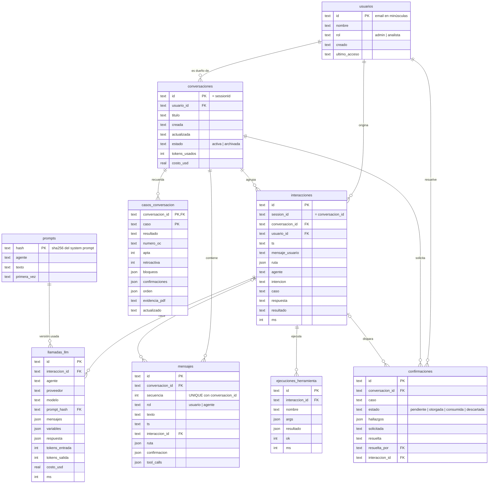

# Modelo de datos

Una sola base SQLite, `out/oc.db` (`bun:sqlite`), guarda dos cosas:

- **El histórico conversacional**: usuarios, conversaciones, mensajes, memoria por caso y confirmaciones humanas.
- **El observatorio del agente**: turnos, llamadas al modelo, herramientas y prompts.

Observatorio y sesiones comparten la misma conexión, abierta una sola vez en `apps/backend/src/main.ts` con `abrirBaseDatos(raiz)`.

- **Código:** `apps/backend/src/persistencia/` (migraciones, conexión, repositorio de sesiones) y `apps/backend/src/observabilidad/` (observador).
- **Migraciones:** versionadas en la tabla `migraciones (version, nombre, aplicada)`. Cada una corre en su transacción y al arrancar solo se aplican las que faltan. Una migración aplicada nunca se edita: los cambios van en una migración nueva.
- **Conexión:** `journal_mode = WAL`, `foreign_keys = ON`, `busy_timeout = 3000`.
- **Formatos:** fechas en ISO 8601 UTC (`2026-10-26T17:57:39.278Z`), JSON en columnas `TEXT` validadas con `json_valid`, y booleanos como `INTEGER` 0/1.

## Diagrama entidad-relación



## Diccionario de datos

### Migración 2: modelo conversacional

| Tabla | Columna | Tipo | Regla |
|---|---|---|---|
| usuarios | id | TEXT PK | Email en minúsculas (`CHECK id = lower(id)`), no vacío |
| usuarios | nombre | TEXT | Opcional; el upsert no lo borra si llega vacío |
| usuarios | rol | TEXT | `admin` o `analista` (por defecto `analista`) |
| usuarios | creado, ultimo_acceso | TEXT | ISO UTC; `ultimo_acceso` se actualiza en cada login (`registrarUsuario`) |
| conversaciones | id | TEXT PK | Es el `sessionId` del chat |
| conversaciones | usuario_id | TEXT FK → usuarios | NULL solo en modo `abierto` (sin login) |
| conversaciones | titulo | TEXT | Primer mensaje del usuario, recortado a 80 |
| conversaciones | estado | TEXT | `activa` o `archivada` |
| conversaciones | tokens_usados, costo_usd | INT, REAL | Acumulados de la sesión, ≥ 0 |
| mensajes | conversacion_id, secuencia | TEXT FK, INT | `UNIQUE`; la secuencia es la posición en el chat (0, 1, 2…) |
| mensajes | rol | TEXT | `usuario` o `agente` |
| mensajes | interaccion_id | TEXT FK → interacciones | Turno que produjo el mensaje (NULL si no hubo observador) |
| mensajes | ruta, confirmacion, tool_calls | JSON | Copia de presentación (`RutaTurno`, confirmación, `ToolCallVisible[]`) para reconstruir el chat tal como se vio |
| casos_conversacion | (conversacion_id, caso) | PK | Memoria del agente por caso dentro de la conversación |
| casos_conversacion | resultado | TEXT | `creada`, `idempotente`, `bloqueada`, `pendiente`, `validado`, `error` o NULL |
| casos_conversacion | apta, retroactiva | INT | 0/1 (`apta` puede ser NULL si aún no se validó) |
| casos_conversacion | bloqueos, confirmaciones, orden | JSON | Códigos RC bloqueantes, hallazgos por confirmar y OC construida |
| confirmaciones | estado | TEXT | `pendiente` → `otorgada` → `consumida`, o `pendiente` → `descartada` |
| confirmaciones | hallazgos | JSON | Hallazgos (RC5, RC6, RC8, RC9) que el humano debía aceptar |
| confirmaciones | solicitada, resuelta | TEXT | `CHECK`: `resuelta` es NULL si y solo si el estado es `pendiente` |
| confirmaciones | resuelta_por | TEXT FK → usuarios | Quien confirmó o descartó; NULL si la descartó el sistema (caso bloqueado) |
| confirmaciones | (conversacion_id, caso) | índice único parcial | A lo sumo una confirmación viva (`pendiente`/`otorgada`) por caso |
| interacciones | conversacion_id, usuario_id | TEXT FK | Agregadas en la migración 2; `session_id` se conserva por compatibilidad |

### Migración 1: observatorio

| Tabla | Columna | Tipo | Regla |
|---|---|---|---|
| interacciones | id | TEXT PK | Un turno de chat |
| interacciones | resultado | TEXT | `ok`, `error`, `confirmacion`, `bloqueado_presupuesto` |
| interacciones | ruta, agente, intencion, caso | JSON / TEXT | Decisión del router (agente, intención, caso) |
| llamadas_llm | interaccion_id | TEXT FK ON DELETE CASCADE | Cada llamada al modelo (router, operador, asesor, conversador, reintentos) |
| llamadas_llm | prompt_hash | TEXT FK → prompts | Versión del system prompt usada |
| llamadas_llm | mensajes, variables, respuesta | JSON | Lo enviado, las variables dinámicas y la respuesta cruda (con secretos redactados) |
| llamadas_llm | tokens_*, costo_usd, ms | INT / REAL | ≥ 0; el gasto global es `SUM(costo_usd)` y se compara con `PRESUPUESTO_USD` |
| ejecuciones_herramienta | ok | INT | 0/1 |
| prompts | hash | TEXT PK | sha256 del system prompt; el texto se guarda una sola vez |

## Ciclo de una confirmación humana

| Momento | Estado en la sesión | Fila en `confirmaciones` |
|---|---|---|
| `oc_crear` devuelve `pendiente` | caso en `pendientes` | INSERT `pendiente` (con `interaccion_id` del turno) |
| El usuario confirma (botón o "confirmo") | caso en `pendientes` y en `confirmacionesOtorgadas` | UPDATE → `otorgada`, `resuelta`, `resuelta_por` |
| Se crea la OC | caso sale de ambas listas | UPDATE → `consumida` |
| El usuario dice "no" | caso sale de `pendientes` | UPDATE → `descartada` (`resuelta_por` = usuario) |
| Un control posterior la bloquea | caso sale de `pendientes`, resultado `bloqueada` | UPDATE → `descartada` (`resuelta_por` NULL = sistema) |

Al recargar una sesión, `pendientes` se rehace con las filas vivas (`pendiente` y `otorgada`) en orden de solicitud, y `confirmacionesOtorgadas` con las `otorgada`.

## Decisiones

- **SQLite en este reto.** Cero infraestructura extra, un archivo, transacciones ACID y `bun:sqlite` sin dependencias. Cumple el PRD, que pide no depender de una base externa. El costo: en Lightsail el disco del contenedor es efímero y un redespliegue borra `oc.db`.
- **Una conexión compartida.** Observatorio y sesiones escriben en la misma base, así las claves foráneas cruzan ambos mundos (mensaje → interacción → llamadas al LLM).
- **Escritura diferencial.** `guardar` reescribe solo el último mensaje ya guardado e inserta los nuevos por secuencia, con un upsert de casos y confirmaciones, todo en una transacción. Si la base falla, el turno sigue en memoria y se registra el error.
- **JSON para estructuras de presentación** (tool calls, hallazgos, OC). Se consultan poco por campo y cambian con el producto. Lo que se filtra o agrega (estado, caso, costo, usuario, fechas) va en columnas tipadas con `CHECK`.
- **Auditoría de confirmaciones aparte de los mensajes.** Así se puede medir sin parsear texto quién aprobó qué excepción, cuándo y en qué turno.

### Qué cambia en producción

- **Motor:** PostgreSQL gestionado (Amazon RDS o Aurora Serverless v2). Los `TEXT` JSON pasan a `JSONB`, los `CHECK` a `ENUM` o dominios, y las fechas a `timestamptz`. Las migraciones se manejan con una herramienta versionada (por ejemplo `node-pg-migrate`).
- **Volumen:** `llamadas_llm` crece rápido, porque guarda los prompts completos. Se particiona por mes (`PARTITION BY RANGE (ts)`) y los payloads grandes (`mensajes`, `respuesta`) se mueven a S3 dejando la referencia.
- **Retención:** 90 días de detalle de llamadas, agregados diarios de costo y tokens sin límite, y conversaciones según la política documental de compras.
- **PII:** los mensajes y prompts pueden contener nombres, correos y NIT. Requieren cifrado en reposo (KMS), acceso por rol (solo `admin` ve el observatorio), redacción de secretos (ya aplicada) y anonimización al vencer la retención. El usuario puede pedir el borrado; `ON DELETE CASCADE` desde conversaciones lo facilita.
- **Concurrencia:** varias réplicas exigen sacar el bloqueo de sesión de memoria a la base (`SELECT … FOR UPDATE` o advisory locks) o a Redis.

## Consultas útiles

```sql
-- Costo de IA por usuario y día
SELECT i.usuario_id, substr(l.ts, 1, 10) AS dia, ROUND(SUM(l.costo_usd), 4) AS costo_usd, COUNT(*) AS llamadas
FROM llamadas_llm l JOIN interacciones i ON i.id = l.interaccion_id
GROUP BY i.usuario_id, dia ORDER BY dia DESC, costo_usd DESC;

-- Confirmaciones: otorgadas (incluye consumidas) vs descartadas
SELECT
  ROUND(100.0 * SUM(estado IN ('otorgada', 'consumida')) / COUNT(*), 1) AS pct_otorgadas,
  ROUND(100.0 * SUM(estado = 'descartada') / COUNT(*), 1) AS pct_descartadas,
  SUM(estado = 'pendiente') AS aun_pendientes
FROM confirmaciones;

-- Tiempo que tarda el humano en confirmar (minutos, mediana aproximada vía promedio)
SELECT caso, ROUND(AVG((julianday(resuelta) - julianday(solicitada)) * 1440), 1) AS minutos
FROM confirmaciones WHERE estado IN ('otorgada', 'consumida') GROUP BY caso;

-- OC retroactivas por conversación (el indicador que pide la dirección)
SELECT c.id, c.titulo, k.caso, k.numero_oc
FROM casos_conversacion k JOIN conversaciones c ON c.id = k.conversacion_id
WHERE k.retroactiva = 1 ORDER BY c.actualizada DESC;

-- % de OC retroactivas sobre las creadas
SELECT ROUND(100.0 * SUM(retroactiva) / COUNT(*), 1) AS pct_retroactivas
FROM casos_conversacion WHERE resultado IN ('creada', 'idempotente');

-- Prompts más costosos (por versión)
SELECT p.agente, substr(p.hash, 1, 12) AS version, COUNT(l.id) AS usos,
       ROUND(SUM(l.costo_usd), 4) AS costo_usd, ROUND(AVG(l.tokens_entrada)) AS tokens_entrada_prom
FROM prompts p JOIN llamadas_llm l ON l.prompt_hash = p.hash
GROUP BY p.hash ORDER BY costo_usd DESC LIMIT 10;

-- Hallazgos que más confirmaciones generan
SELECT json_extract(h.value, '$.codigo') AS regla, COUNT(*) AS veces
FROM confirmaciones, json_each(confirmaciones.hallazgos) h
GROUP BY regla ORDER BY veces DESC;

-- Conversación completa reconstruida con el costo de cada turno
SELECT m.secuencia, m.rol, substr(m.texto, 1, 80) AS texto,
       (SELECT ROUND(SUM(costo_usd), 5) FROM llamadas_llm l WHERE l.interaccion_id = m.interaccion_id) AS costo_turno
FROM mensajes m WHERE m.conversacion_id = :id ORDER BY m.secuencia;
```
